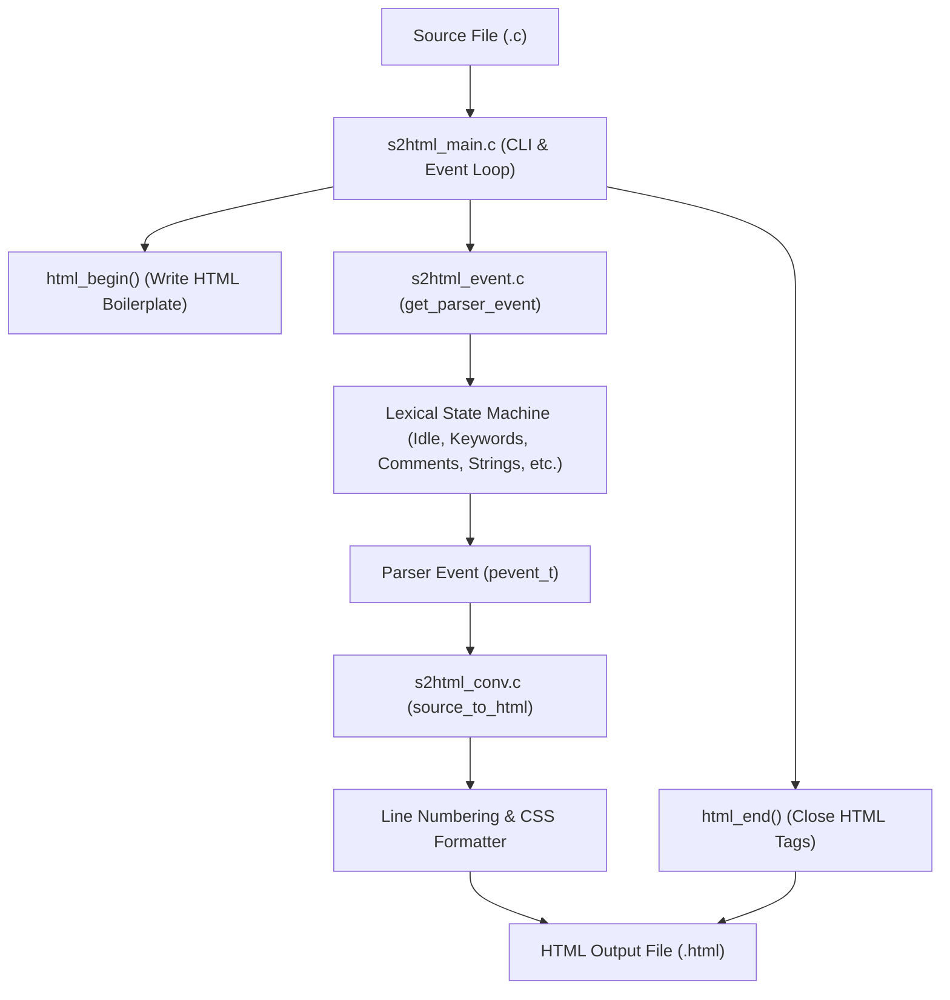
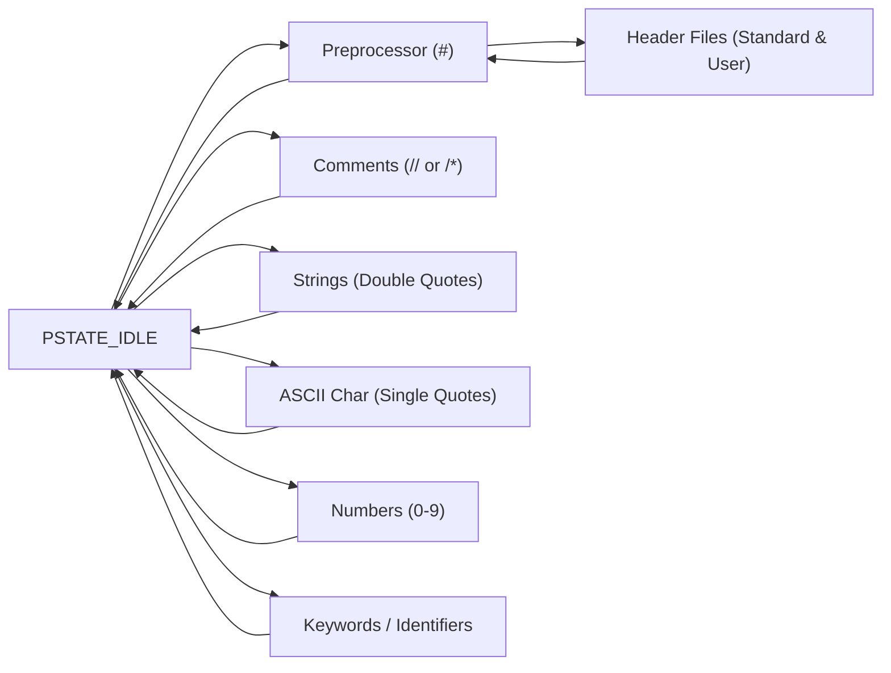

# Source2HTML (s2html)

**Source2HTML** is an event-driven C source code syntax highlighter that parses C source files and converts them into syntax-highlighted HTML documents viewable in any modern web browser.

---

## 🏗️ Architecture & Program Flow

The application follows a modular **State-Event Parser Engine** architecture:
1. **`s2html_main.c`**: Coordinates the conversion, parses command-line arguments (including `-n` for line numbers), and drives the event loop.
2. **`s2html_event.c`**: Lexical analyzer that tokenizes source code into structured events (`pevent_t`).
3. **`s2html_conv.c`**: Formatter that wraps tokens in CSS `<span>` classes, handles line numbers, and escapes HTML entities.



---

## 🔄 State Transition Overview



---

## 🎨 Syntax Highlighting & Color Scheme

Tokens are categorized into the following CSS classes defined in [`styles.css`](styles.css):

| Token Category | Event Type | CSS Class | Color | Examples |
|---|---|---|---|---|
| **Data Keywords** | `PEVENT_RESERVE_KEYWORD` (`RES_KEYWORD_DATA`) | `.reserved_key1` | 🟩 Green | `int`, `char`, `float`, `void`, `struct`, `const`, `static` |
| **Non-Data Keywords** | `PEVENT_RESERVE_KEYWORD` (`RES_KEYWORD_NON_DATA`) | `.reserved_key2` | 🟨 Goldenrod | `if`, `else`, `for`, `while`, `return`, `switch`, `case` |
| **Preprocessor Directives** | `PEVENT_PREPROCESSOR_DIRECTIVE` | `.preprocess_dir` | 🟪 Purple | `#include`, `#define`, `#ifdef`, `#ifndef`, `#endif` |
| **Header Files** | `PEVENT_HEADER_FILE` | `.header_file` | 🟥 Red | `<stdio.h>`, `"s2html_event.h"` |
| **Comments** | `PEVENT_SINGLE_LINE_COMMENT`, `PEVENT_MULTI_LINE_COMMENT` | `.comment` | 🟦 Blue | `// comment`, `/* multi-line comment */` |
| **Strings** | `PEVENT_STRING` | `.string` | 🟪 Magenta | `"Hello, World!\n"`, `"test \"quote\""` |
| **Numeric Constants** | `PEVENT_NUMERIC_CONSTANT` | `.numeric_constant` | 🟫 Brown | `42`, `0xFF`, `3.14`, `100UL` |
| **ASCII Characters** | `PEVENT_ASCII_CHAR` | `.ascii_char` | 🟧 Firebrick | `'a'`, `'\n'`, `'\\'`, `'\''` |
| **Identifiers & Plain Code**| `PEVENT_REGULAR_EXP` | *(none)* | ⬛ Default Text | `my_var`, `calculate_sum`, `(`, `)`, `;`, `+`, `-` |

---

## 📁 File Structure

- **[`s2html_main.c`](s2html_main.c)**: Program entry point; handles command-line arguments (including `-n`) and coordinates the conversion pipeline.
- **[`s2html_event.h`](s2html_event.h)**: Defines parser event enums (`pevent_e`), event structure (`pevent_t`), and property constants.
- **[`s2html_event.c`](s2html_event.c)**: Implementation of the finite state machine parser engine.
- **[`s2html_conv.h`](s2html_conv.h)**: Function prototypes for HTML opening/closing and event conversion.
- **[`s2html_conv.c`](s2html_conv.c)**: HTML generator that wraps tokens in `<span class="...">` tags, handles line numbers, and escapes HTML entities (`<`, `>`, `&`).
- **[`styles.css`](styles.css)**: CSS stylesheet applying the syntax highlighting color palette.

---

## ⚙️ Compilation & Usage

### 1. Compilation
Compile all source files using `gcc`:
```bash
gcc -Wall -Wextra s2html_main.c s2html_conv.c s2html_event.c -o s2html
```

### 2. Usage Syntax
```bash
./s2html <source file> [output file] [-n]
```

#### Examples:
```bash
# 1. Convert source file to source.c.html (default output)
./s2html source.c

# 2. Convert source file with line numbering enabled
./s2html source.c -n

# 3. Convert with a custom output filename
./s2html source.c output.html

# 4. Convert with custom output filename and line numbers
./s2html source.c output.html -n
```

### 3. Viewing the Output
Open the generated HTML file in any browser:
```bash
# Linux
xdg-open output.html

# macOS
open output.html
```
